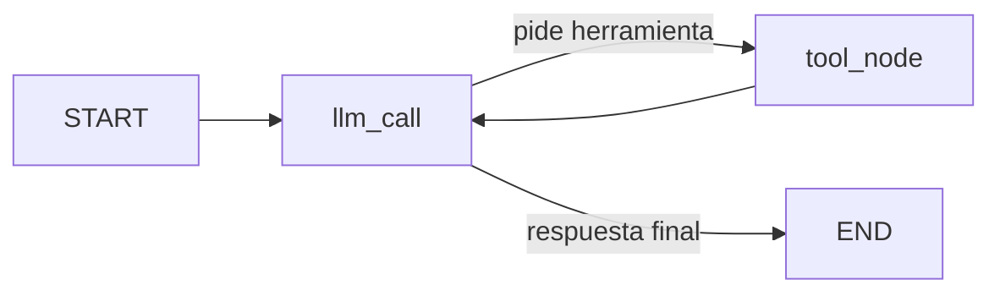

# Websearch Agent: evaluación de Tavily como search tool

Agente construido con **LangGraph** y **Claude Haiku 4.5** que decide cuándo responder con su conocimiento y cuándo buscar en la web con **Tavily**. El proyecto sirve para evaluar Tavily como `search_tool` de un chatbot de consultas web: cuándo se usa, cuántos tokens cuesta y cómo mejorar su coste y relevancia.

## Contexto y objetivo

La empresa quiere implementar un chatbot para consultas web. El objetivo es entender cómo se comporta Tavily dentro de un agente y si se puede mejorar su coste o su rendimiento.

| Paso | Contenido | Estado |
|---|---|---|
| 1 | Comprobar que el agente busca cuando debe · acceder a los `ToolMessage` · medir `token_usage` y el peso de los `ToolMessage` | Implementado |
| 2 | Entender el `search_tool`: estructura, snippets, score, parámetros, schema de `bind_tools()`, ¿el modelo usa los resultados o alucina? | Pendiente |
| 3 | Mejorar coste y relevancia: filtrar por score, no inyectar búsquedas infructuosas, prompt caching, relevancia evaluada por el LLM con un schema pydantic | Pendiente |

## Estructura del proyecto

```
.
├── .env                        # claves (NO se sube a git)
├── .gitignore
├── pyproject.toml
├── uv.lock
├── README.md
├── notebooks/
│   ├── notebook-websearch-eval.ipynb   # proyecto de evaluación (planteamiento, Paso 1, resultados)
│   ├── notebook-agente-v2.ipynb        # demo del agente v2
│   └── ...                             # versiones anteriores (agente básico)
└── src/
    └── victorg_langgraph_websearchagent/
        ├── __init__.py
        ├── agent.py            # agente básico (v1)
        └── agent_v2.py         # agente con cutoff, tokens y ToolMessages (v2)
```

La lógica vive en `agent_v2.py`. Los notebooks solo importan sus funciones y muestran resultados.

## Instalación

Requisitos: Python 3.12 y [`uv`](https://docs.astral.sh/uv/).

```bash
uv sync
```

Crea un archivo `.env` en la raíz con tus claves, sin comillas ni espacios alrededor del `=`:

```
ANTHROPIC_API_KEY=sk-ant-...
TAVILY_API_KEY=tvly-...
```

> **Importante:** comprueba que `.env` está en `.gitignore` antes de hacer commit.

### Ejecución

Desde la terminal:

```bash
uv run python src/victorg_langgraph_websearchagent/agent_v2.py
```

Desde un notebook: elige el kernel `.venv` del proyecto y ejecuta las celdas en orden.

```python
from victorg_langgraph_websearchagent.agent_v2 import load_keys, build_search_agent, run_agent, get_answer

load_keys()
agent = build_search_agent()
result = run_agent(agent, "¿Cuál es la última versión estable de LangGraph?")
print(get_answer(result))
```

## Cómo funciona el agente

### Grafo



- `llm_call`: el modelo recibe el system prompt y la conversación. Responde o pide una herramienta.
- `tool_node`: ejecuta la herramienta pedida y guarda el resultado en un `ToolMessage` (contenido en JSON, con el nombre de la herramienta).
- `should_continue`: si el último mensaje tiene `tool_calls`, va a `tool_node`; si no, termina.

### Herramientas

| Herramienta | Qué hace |
|---|---|
| `tavily_search` | Búsqueda web (`max_results=5`, `topic="general"`) |
| `multiply` | Multiplica dos enteros (herramienta de prueba) |

### Corte de conocimiento y fecha en el system prompt

En lugar de crear una herramienta para la fecha, el **system prompt** inyecta el corte de conocimiento (`KNOWLEDGE_CUTOFF = "julio de 2025"`) y la fecha de hoy. Las reglas son:

1. Conocimiento anterior al corte o atemporal: responder sin buscar.
2. Información actual o posterior al corte: usar `tavily_search`.
3. Si el modelo no sabe o no puede contestar con seguridad: buscar.

Así el modelo sabe cuándo buscar sin gastar una llamada a una herramienta de fecha.

> La documentación de Anthropic distingue para Haiku 4.5 dos fechas: *training data cutoff* (julio 2025) y *reliable knowledge cutoff* (febrero 2025). El proyecto usa julio 2025; la comparación con y sin búsqueda del notebook sirve para ver si esa diferencia afecta a las respuestas. Haiku 4.5 figura como modelo *legacy*; el modelo se cambia en la constante `MODEL_NAME`.

### Agente sin búsqueda

`build_search_agent(use_search=False)` crea el mismo agente **sin Tavily** y con el mismo prompt (más un aviso de que no hay búsqueda). Permite comprobar si una búsqueda estaba justificada comparando las dos respuestas.

## API del script (`agent_v2.py`)

| Función | Qué hace |
|---|---|
| `load_keys()` | Carga las claves del `.env` (el `.env` manda) y las pide si faltan |
| `build_system_prompt(use_search)` | Prompt con corte de conocimiento y fecha de hoy |
| `build_search_agent(use_search=True)` | Crea y compila el agente |
| `run_agent(agent, pregunta, verbose=False)` | Ejecuta el agente y devuelve el resultado completo |
| `get_answer(result)` | Texto de la respuesta final |
| `used_search(result)` | `True` si usó la búsqueda web |
| `get_tool_messages(result)` | Lista de `ToolMessage` de la ejecución |
| `print_tool_messages(result)` | Muestra los `ToolMessage` de forma legible |
| `count_tokens(result)` / `print_tokens(result)` | Tokens por llamada, totales y tokens del tool call |
| `toolmessage_tokens(result)` | Tokens, peso y coste de los `ToolMessage` |
| `print_toolmessage_weight(result)` | Lo anterior, con la cuenta paso a paso |
| `verify_toolmessage_tokens(result)` | Contrasta el cálculo con el endpoint `count_tokens` de Anthropic |
| `print_summary(queries, results)` | Tabla: esperado vs. real, tokens |
| `print_weight_summary(queries, results)` | Tabla: peso de los `ToolMessage` por query |
| `compare_agents(pregunta, agent, agent_plain)` | Responde con y sin búsqueda |

## Paso 1: tokens de los ToolMessages

### Qué da la API

Cada respuesta del modelo trae `usage_metadata` con `input_tokens`, `output_tokens` y `total_tokens` **de esa llamada**. La API **no** da los tokens de cada mensaje por separado, así que los de un `ToolMessage` se deducen.

### Cómo se calculan

En cada llamada el modelo recibe todo el contexto acumulado. Con una herramienta hay dos llamadas:

```
Llamada 1   input I1 = system prompt + schemas de las tools + pregunta
            output O1 = el tool_call (lo genera el modelo)

Llamada 2   input I2 = system prompt + schemas de las tools + pregunta
                       + tool_call + ToolMessage
```

Al restar `I2 - I1`, lo que se repite (system prompt, schemas, pregunta) se cancela. Queda el tool_call, que vuelve a entrar como input, más el `ToolMessage`. El tool_call ocupa `O1` tokens, los mismos que generó el modelo. Por tanto:

```
tokens del ToolMessage = I2 - I1 - O1
```

### tool_call frente a ToolMessage

| | tool_call | ToolMessage |
|---|---|---|
| Quién lo escribe | el modelo | la herramienta (Tavily) |
| Cómo se factura | *output* la primera vez y luego *input* | solo *input* |
| Cómo se mide | directamente (`output_tokens` de la llamada 1) | por diferencia: `I2 - I1 - O1` |

### Peso y coste

- **Se factura en cada llamada posterior.** El `ToolMessage` queda en el contexto: si después lo arrastran *n* llamadas, se paga *n* veces como input. `input_facturado = tokens × n`.
- **Peso** = `input_facturado` / input total (o / tokens totales).
- **Coste** = `input_facturado` × precio de entrada de Haiku 4.5 (1 USD por millón de tokens, según la documentación).

### Limitaciones

- Es una **deducción**, no una medida directa. Incluye unos pocos tokens de estructura (`tool_use` / `tool_result`) y puede haber una diferencia mínima al volver a codificar el tool_call.
- `verify_toolmessage_tokens` lo contrasta contando con el endpoint `count_tokens` de Anthropic el texto del `ToolMessage`. Si no hay clave o red, avisa y continúa.
- Si una ronda tiene varias herramientas a la vez, el cálculo da el total de la ronda, no el de cada `ToolMessage`.

## Batería de pruebas

El notebook `notebook-websearch-eval.ipynb` ejecuta 15 queries, cada una con el comportamiento esperado:

| Tipo | Ejemplos | Esperado |
|---|---|---|
| Estático / atemporal | Don Quijote, teorema de Pitágoras, Mundial Qatar 2022 | sin web |
| Fecha inyectada | "¿Qué día es hoy?" | sin web |
| Herramienta `multiply` | "Multiplica 123 por 456" | sin web |
| Información actual | última versión de LangGraph, tiempo en Madrid, precio del Bitcoin | web |
| Casos límite del corte | Champions 2024-25, Mundial de Clubes 2025, Tour de Francia 2025 | según la fecha |
| Mezcla | multiplicación + versión de LangGraph | web |

## Pasos siguientes

**Paso 2: entender y evaluar la tool**

- Qué devuelve Tavily y cuál es la estructura del mensaje.
- Qué parámetros ve el LLM con `bind_tools()` (los schemas que se inyectan en el primer input).
- Cómo se generan los snippets y el score, y si el score refleja relevancia real.
- Si el modelo usa realmente las respuestas o alucina.

**Paso 3: mejorar coste y relevancia**

- A nivel de parámetros de la tool y a nivel del agente.
- Pruebas previstas: no inyectar búsquedas infructuosas, filtrar por score bajo, prompt caching y evaluación de relevancia por el LLM con un schema pydantic (relevancia y explicación).

## Resultados

*(Completar con los números reales tras ejecutar `notebook-websearch-eval.ipynb`.)*

| Métrica | Valor |
|---|---|
| Queries donde el comportamiento coincide con lo esperado | _ / 15 |
| Tokens medios de un `ToolMessage` de Tavily | _ |
| Peso medio en el input total | _ % |
| Coste medio de los `ToolMessage` por búsqueda | _ USD |
| Diferencia entre `I2 - I1 - O1` y `count_tokens` | _ tokens |

## Conclusiones

*(Completar al terminar los tres pasos.)*

## Referencias

- [Claude Haiku 4.5 (documentación)](https://platform.claude.com/docs/en/models/haiku-4-5/overview)
- [LangGraph](https://langchain-ai.github.io/langgraph/)
- [Tavily](https://tavily.com/)
