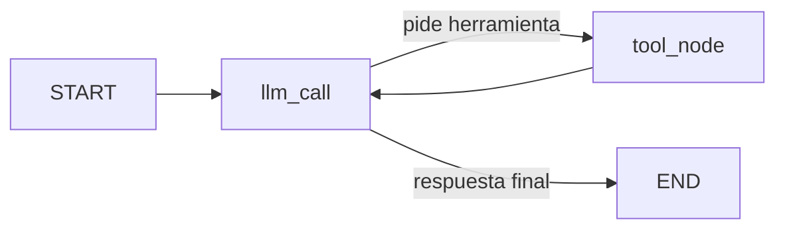

# Websearch Agent: evaluación de Tavily como search tool

Agente construido con **LangGraph** y **Claude Haiku 4.5** que decide cuándo responder con su conocimiento y cuándo buscar en la web con **Tavily**. El proyecto sirve para evaluar Tavily como `search_tool` de un chatbot de consultas web: cuándo se usa, cuántos tokens cuesta y cómo mejorar su coste y relevancia.

## Contexto y objetivo

La empresa quiere implementar un chatbot para consultas web. El objetivo es entender cómo se comporta Tavily dentro de un agente y si se puede mejorar su coste o su rendimiento.

| Paso | Contenido | Estado |
|---|---|---|
| 1 | Comprobar que el agente busca cuando debe · acceder a los `ToolMessage` · medir `token_usage` y el peso de los `ToolMessage` | Hecho, con resultados |
| 2 | Entender el `search_tool`: estructura, snippets, score, parámetros, schema de `bind_tools()`, ¿el modelo usa los resultados o alucina? | Hecho, con resultados |
| 3 | Mejorar coste y relevancia: filtrar por score, no inyectar búsquedas infructuosas, prompt caching, relevancia evaluada por el LLM con un schema pydantic | Pendiente |

## Estructura del proyecto

```
.
├── .env                        # claves (NO se sube a git)
├── .gitignore
├── pyproject.toml
├── uv.lock
├── README.md
├── notebooks/
│   ├── notebook-websearch-eval.ipynb   # proyecto de evaluación (planteamiento, Paso 1, resultados)
│   ├── notebook-agente-v2.ipynb        # demo del agente v2
│   └── ...                             # versiones anteriores (agente básico)
└── src/
    └── victorg_langgraph_websearchagent/
        ├── __init__.py
        ├── agent.py            # agente básico (v1)
        └── agent_v2.py         # agente con cutoff, tokens y ToolMessages (v2)
```

La lógica vive en `agent_v2.py`. Los notebooks solo importan sus funciones y muestran resultados.

## Instalación

Requisitos: Python 3.12 y [`uv`](https://docs.astral.sh/uv/).

```bash
uv sync
```

Crea un archivo `.env` en la raíz con tus claves, sin comillas ni espacios alrededor del `=`:

```
ANTHROPIC_API_KEY=sk-ant-...
TAVILY_API_KEY=tvly-...
```

> **Importante:** comprueba que `.env` está en `.gitignore` antes de hacer commit.

### Ejecución

Desde la terminal:

```bash
uv run python src/victorg_langgraph_websearchagent/agent_v2.py
```

Desde un notebook: elige el kernel `.venv` del proyecto y ejecuta las celdas en orden.

```python
from victorg_langgraph_websearchagent.agent_v2 import load_keys, build_search_agent, run_agent, get_answer

load_keys()
agent = build_search_agent()
result = run_agent(agent, "¿Cuál es la última versión estable de LangGraph?")
print(get_answer(result))
```

## Cómo funciona el agente

### Grafo



- `llm_call`: el modelo recibe el system prompt y la conversación. Responde o pide una herramienta.
- `tool_node`: ejecuta la herramienta pedida y guarda el resultado en un `ToolMessage` (contenido en JSON, con el nombre de la herramienta).
- `should_continue`: si el último mensaje tiene `tool_calls`, va a `tool_node`; si no, termina.

### Herramientas

| Herramienta | Qué hace |
|---|---|
| `tavily_search` | Búsqueda web (`max_results=5`, `topic="general"`) |
| `multiply` | Multiplica dos enteros (herramienta de prueba) |

### Corte de conocimiento y fecha en el system prompt

En lugar de crear una herramienta para la fecha, el **system prompt** inyecta el corte de conocimiento (`KNOWLEDGE_CUTOFF = "julio de 2025"`) y la fecha de hoy. Las reglas son:

1. Conocimiento anterior al corte o atemporal: responder sin buscar.
2. Información actual o posterior al corte: usar `tavily_search`.
3. Si el modelo no sabe o no puede contestar con seguridad: buscar.

Así el modelo sabe cuándo buscar sin gastar una llamada a una herramienta de fecha.

> La documentación de Anthropic distingue para Haiku 4.5 dos fechas: *training data cutoff* (julio 2025) y *reliable knowledge cutoff* (febrero 2025). El proyecto usa julio 2025; la comparación con y sin búsqueda del notebook sirve para ver si esa diferencia afecta a las respuestas. Haiku 4.5 figura como modelo *legacy*; el modelo se cambia en la constante `MODEL_NAME`.

### Agente sin búsqueda

`build_search_agent(use_search=False)` crea el mismo agente **sin Tavily** y con el mismo prompt (más un aviso de que no hay búsqueda). Permite comprobar si una búsqueda estaba justificada comparando las dos respuestas.

## API del script (`agent_v2.py`)

| Función | Qué hace |
|---|---|
| `load_keys()` | Carga las claves del `.env` (el `.env` manda) y las pide si faltan |
| `build_system_prompt(use_search)` | Prompt con corte de conocimiento y fecha de hoy |
| `build_search_agent(use_search=True)` | Crea y compila el agente |
| `run_agent(agent, pregunta, verbose=False)` | Ejecuta el agente y devuelve el resultado completo |
| `get_answer(result)` | Texto de la respuesta final |
| `used_search(result)` | `True` si usó la búsqueda web |
| `get_tool_messages(result)` | Lista de `ToolMessage` de la ejecución |
| `print_tool_messages(result)` | Muestra los `ToolMessage` de forma legible |
| `count_tokens(result)` / `print_tokens(result)` | Tokens por llamada, totales y tokens del tool call |
| `toolmessage_tokens(result)` | Tokens, peso y coste de los `ToolMessage` |
| `print_toolmessage_weight(result)` | Lo anterior, con la cuenta paso a paso |
| `verify_toolmessage_tokens(result)` | Contrasta el cálculo con el endpoint `count_tokens` de Anthropic |
| `print_summary(queries, results)` | Tabla: esperado vs. real, tokens |
| `print_weight_summary(queries, results)` | Tabla: peso de los `ToolMessage` por query |
| `compare_agents(pregunta, agent, agent_plain)` | Responde con y sin búsqueda |
| `build_tools(use_search, search_kwargs)` | Lista de herramientas; `search_kwargs` configura Tavily |
| `get_tavily_outputs(result)` / `print_tavily_structure(output)` | Salida de Tavily como diccionario y su estructura |
| `print_tool_schemas(tools)` | Schemas que recibe el modelo tras `bind_tools()` |
| `print_tavily_parameters(search_tool)` | Qué parámetros decide el LLM y cuáles se ignoran o son solo de instanciación |
| `print_tool_schema_tokens(tools)` | Tokens de los schemas (total, por tool y parte fija) con `count_tokens` |
| `inspect_snippets(query)` / `print_snippet_report(...)` | Compara cada snippet con la página completa |
| `judge_results_relevance(query, output)` | Un LLM puntúa la relevancia (0-3) de cada resultado (schema pydantic) |
| `print_score_vs_relevance(judged)` | ¿El score de Tavily ordena igual que el juez? |
| `evaluate_groundedness(queries, results)` / `print_groundedness(...)` | ¿La respuesta se apoya en los resultados o alucina? |

## Paso 1: tokens de los ToolMessages

### Qué da la API

Cada respuesta del modelo trae `usage_metadata` con `input_tokens`, `output_tokens` y `total_tokens` **de esa llamada**. La API **no** da los tokens de cada mensaje por separado, así que los de un `ToolMessage` se deducen.

### Cómo se calculan

En cada llamada el modelo recibe todo el contexto acumulado. Con una herramienta hay dos llamadas:

```
Llamada 1   input I1 = system prompt + schemas de las tools + pregunta
            output O1 = el tool_call (lo genera el modelo)

Llamada 2   input I2 = system prompt + schemas de las tools + pregunta
                       + tool_call + ToolMessage
```

Al restar `I2 - I1`, lo que se repite (system prompt, schemas, pregunta) se cancela. Queda el tool_call, que vuelve a entrar como input, más el `ToolMessage`. El tool_call ocupa `O1` tokens, los mismos que generó el modelo. Por tanto:

```
tokens del ToolMessage = I2 - I1 - O1
```

### tool_call frente a ToolMessage

| | tool_call | ToolMessage |
|---|---|---|
| Quién lo escribe | el modelo | la herramienta (Tavily) |
| Cómo se factura | *output* la primera vez y luego *input* | solo *input* |
| Cómo se mide | directamente (`output_tokens` de la llamada 1) | por diferencia: `I2 - I1 - O1` |

### Peso y coste

- **Se factura en cada llamada posterior.** El `ToolMessage` queda en el contexto: si después lo arrastran *n* llamadas, se paga *n* veces como input. `input_facturado = tokens × n`.
- **Peso** = `input_facturado` / input total (o / tokens totales).
- **Coste** = `input_facturado` × precio de entrada de Haiku 4.5 (1 USD por millón de tokens, según la documentación).

### Limitaciones

- Es una **deducción**, no una medida directa. Incluye unos pocos tokens de estructura (`tool_use` / `tool_result`) y puede haber una diferencia mínima al volver a codificar el tool_call.
- `verify_toolmessage_tokens` lo contrasta contando con el endpoint `count_tokens` de Anthropic el texto del `ToolMessage`. Si no hay clave o red, avisa y continúa.
- Si una ronda tiene varias herramientas a la vez, el cálculo da el total de la ronda, no el de cada `ToolMessage`.

## Paso 2: entender y evaluar Tavily

### Conceptos

- **`bind_tools()`** convierte cada tool en un schema JSON (nombre, descripción y parámetros) que se envía **en cada llamada** al modelo, aunque no se use la tool.
- **Snippet (`content`)**: según la [documentación de Tavily](https://docs.tavily.com/api-reference/endpoint/search), son *chunks* cortos extraídos tal cual de la página (unos 500 caracteres en `basic` y `fast`, 800 en `advanced`), hasta `chunks_per_source` por URL (3 por defecto), unidos por `[...]`. `ultra-fast` devuelve un resumen NLP por URL.
- **Score**: puntuación de relevancia entre la query y el contenido. Tavily no documenta cómo se calcula ni recomienda un umbral fijo; el notebook lo trata como una caja negra y lo contrasta con un juez independiente.

### Qué se ha comprobado en el código (`langchain-tavily` 0.2.18)

- El LLM ve **9 parámetros** de `TavilySearch`: `query`, `include_domains`, `exclude_domains`, `search_depth`, `include_images`, `time_range`, `topic`, `start_date` y `end_date`. El schema de Tavily ocupa unos 6.400 caracteres de JSON, y por eso las tools suman del orden de 2000 tokens en cada llamada (el notebook lo mide con `count_tokens`).
- **Un parámetro fijado al crear la tool gana sobre el que ponga el LLM.** En este proyecto `topic="general"` está fijado: el LLM sigue viendo el parámetro (y pagando sus tokens), pero su valor se ignora.
- `max_results`, `include_answer`, `include_raw_content`, `include_image_descriptions`, `country`, `include_favicon`, `include_usage`, `exact_match` y `auto_parameters` solo se pueden fijar al crear la tool; el LLM no los ve.
- **`search_depth` lo elige el LLM** porque no está fijado. Según la documentación, `advanced` cuesta 2 créditos de API frente a 1 de `basic`.
- `chunks_per_source` no es un parámetro de `TavilySearch` en esta versión: el LLM no puede cambiarlo y se usa el valor por defecto.
- Si Tavily no devuelve resultados, la tool lanza una `ToolException`. `tool_node` la captura y devuelve el error como `ToolMessage` para que el grafo no se rompa.

### Preguntas y cómo se responden en el notebook

| Pregunta | Cómo se evalúa |
|---|---|
| ¿Qué devuelve y cuál es la estructura? | `print_tavily_structure`: claves, campos y peso de cada campo |
| ¿Qué ve el LLM con `bind_tools()`? | `print_tool_schemas`, `print_tavily_parameters` y `print_tool_schema_tokens` |
| ¿Cómo se generan los snippets? | `inspect_snippets` pide también la página completa y comprueba si los chunks son literales y de qué parte salen |
| ¿Son la parte relevante de la página? | Cobertura de términos de la query en el snippet frente a la mejor ventana de 500 caracteres de la página, más lectura manual |
| ¿Cómo se genera el score y es coherente con la relevancia? | Un LLM puntúa cada snippet de 0 a 3 (schema pydantic) y se mide si el score ordena igual |
| ¿El modelo usa las respuestas o alucina? | Un LLM comprueba que las afirmaciones de la respuesta estén en los snippets, y se listan los números que no aparecen en las fuentes |

### Limitaciones

- El juez es el mismo modelo (Haiku 4.5) y solo ve el snippet, no la página: sus valoraciones son una guía, no la verdad absoluta.
- La comparación snippet/página es léxica: cuenta términos, no mide significado.

## Batería de pruebas

El notebook `notebook-websearch-eval.ipynb` ejecuta 15 queries, cada una con el comportamiento esperado:

| Tipo | Ejemplos | Esperado |
|---|---|---|
| Estático / atemporal | Don Quijote, teorema de Pitágoras, Mundial Qatar 2022 | sin web |
| Fecha inyectada | "¿Qué día es hoy?" | sin web |
| Herramienta `multiply` | "Multiplica 123 por 456" | sin web |
| Información actual | última versión de LangGraph, tiempo en Madrid, precio del Bitcoin | web |
| Casos límite del corte | Champions 2024-25, Mundial de Clubes 2025, Tour de Francia 2025 | según la fecha |
| Mezcla | multiplicación + versión de LangGraph | web |

## Pasos siguientes

**Paso 3: mejorar coste y relevancia**

- A nivel de parámetros de la tool y a nivel del agente.
- Pruebas previstas: no inyectar búsquedas infructuosas, filtrar por score bajo, prompt caching y evaluación de relevancia por el LLM con un schema pydantic (relevancia y explicación).

## Resultados

Ejecución real con `claude-haiku-4-5` y Tavily (`max_results=5`, `topic="general"`). Los detalles y las salidas están en `notebooks/notebook-websearch-eval.ipynb`.

### Paso 1: comportamiento y tokens

| Métrica | Valor |
|---|---|
| Queries donde el comportamiento coincide con lo esperado | **14 / 15** |
| Query sin herramientas (tokens totales) | 2.583 - 3.071, de los que ~2.260 son schemas |
| Tokens medios de un `ToolMessage` de Tavily (8 queries con web) | **2.874** (mín. 2.341, máx. 4.474) |
| Peso medio del `ToolMessage` en el input total | **35%** |
| Coste medio de los `ToolMessage` por búsqueda | **0,00287 USD** |
| Diferencia entre `I2 - I1 - O1` y `count_tokens` | **12 tokens** (2.341 frente a 2.329) |

- La única ✗ es "Champions 2024-2025": usó la web. La final fue en mayo de 2025, posterior al conocimiento fiable de Haiku 4.5 (febrero de 2025 según la documentación), así que buscar es defendible.
- La fecha inyectada en el system prompt funciona: "¿Qué día es hoy?" se responde sin buscar.

**Dónde se va el coste de una búsqueda** (query de LangGraph: 7.553 tokens de input, 365 de output, 0,0094 USD):

| Concepto | Tokens | Coste | % del coste |
|---|---|---|---|
| Schemas de las tools (2 llamadas x 2.260) | 4.520 | 0,00452 | **48%** |
| `ToolMessage` de Tavily | 2.341 | 0,00234 | 25% |
| Resto del input (system prompt, pregunta, tool_call) | 692 | 0,00069 | 7% |
| Output | 365 | 0,00183 | 19% |

### Paso 2: la search tool

| Métrica | Valor |
|---|---|
| Tokens de los schemas de las tools (total / solo Tavily) | **2.260 / 1.676** (más 88 de `multiply` y 496 fijos) |
| Peso del `content` (snippet) en el JSON de Tavily | **82%** |
| Resultados con página donde el snippet aparece tal cual en `raw_content` | 2 de 12 (3 parcialmente, 7 nada) |
| Resultados donde hay un pasaje mejor en la página | 3 de 12 |
| Score medio: resultados relevantes / poco relevantes | 0,77 / 0,85 (solo 1 poco relevante) |
| Coincidencia del orden score/relevancia | 75% y 100% (1 query sin pares comparables) |
| Respuestas con web respaldadas por los resultados | 6 de 8 con el evaluador original; las 2 restantes eran fallos del evaluador (corregidos, pendiente de re-ejecutar) |

## Conclusiones

### Paso 1

- **El agente decide bien cuándo buscar** (14 de 15) y la inyección de corte de conocimiento y fecha en el system prompt sustituye con éxito a un tool de fecha.
- **El `ToolMessage` de Tavily cuesta de media 2.874 tokens y es el 35% del input** de una búsqueda. Su cálculo por diferencia (`I2 - I1 - O1`) coincide con el recuento directo con 12 tokens de diferencia.
- **El mayor coste no es el resultado de Tavily, sino los schemas de las tools** (48% del coste de una búsqueda), porque se envían en cada llamada. Incluso una pregunta sin herramientas gasta ~2.260 tokens en schemas.

### Paso 2

- **Estructura:** casi todo el peso de la salida es el `content`; `score`, `id`, `url` y `title` suman menos del 10%.
- **Schema:** el LLM ve 9 parámetros de Tavily y solo `topic` está fijado. El 73% del schema son descripciones de parámetros.
- **Snippets:** son ~3 chunks (1.100-1.500 caracteres) de la página. Suelen ser relevantes, pero incluyen ruido: referencias bibliográficas (Wikipedia), texto de navegación (DAZN, ESPN) y banners (npm).
- **Score:** con esta muestra no discrimina (0,77 de media en relevantes frente a 0,85 en el único poco relevante) y hay resultados útiles con score 0,54-0,65, así que **un umbral alto descartaría resultados relevantes**. Mide parecido con la consulta, no frescura: para LangGraph llegan las versiones 1.2.7, 1.2.16 y 1.4.15 (esta última, el paquete de JavaScript).
- **Alucinaciones:** no hay evidencia clara. Las dos respuestas marcadas como no respaldadas eran fallos del evaluador (el `408` venía de `multiply`; los números se comparaban como texto), ya corregidos en `agent_v2.py`.
- **Limitaciones:** muestra pequeña (3 queries para snippets y score), juez benévolo y que es el mismo modelo, y comparación snippet/página léxica.

### Hipótesis para el Paso 3 (a medir)

1. Tool propia con schema mínimo (solo `query`): ahorro estimado del orden de 1.500 tokens por llamada.
2. `ToolMessage` más pequeño: menos resultados, recortar el `content` o quitar el ruido.
3. Filtro por score con umbral bajo, o quedarse con los k mejores.
4. Prompt caching del prefijo (system prompt + tools): comprobar si supera el mínimo cacheable del modelo.
5. Juez de relevancia dentro del agente: solo compensa si evita búsquedas inútiles o respuestas peores.

## Referencias

- [Claude Haiku 4.5 (documentación)](https://platform.claude.com/docs/en/models/haiku-4-5/overview)
- [LangGraph](https://langchain-ai.github.io/langgraph/)
- [Tavily](https://tavily.com/)
