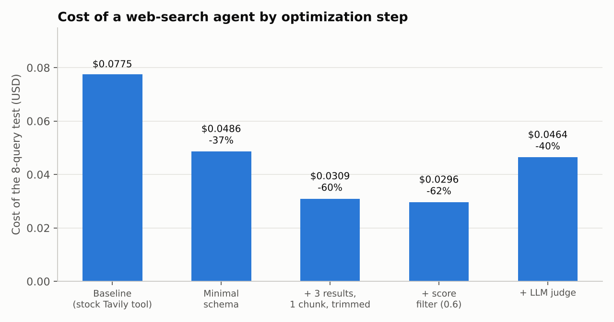
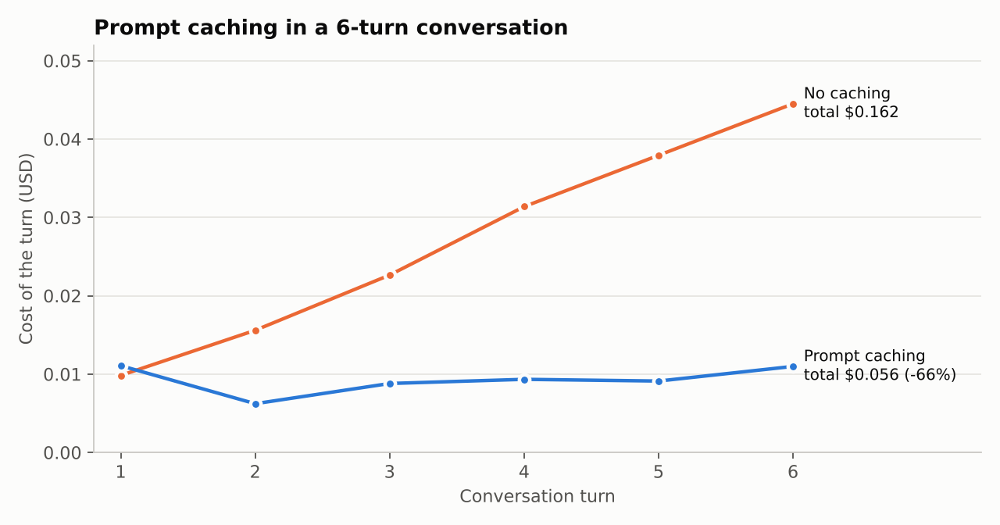

# Cutting the Cost of Web Search in LLM Agents: Evaluating Tavily in LangGraph


An empirical study of what a web-search tool really costs inside a **LangGraph** agent (**Claude Haiku 4.5** + **Tavily**), and how to cut that cost without hurting answer quality. Everything is measured with real API calls: tokens, USD, snippet relevance and groundedness.

**Headline results**

- The search tool's JSON schema is the biggest hidden cost (**~48 % of a search query's cost**), billed on *every* model call, even when no tool is used.
- A minimal custom tool plus trimmed results cut the cost of the test set by **60 %** (**62 %** with a score filter) with no measurable quality loss.
- **Prompt caching** cut a 6-turn conversation by **66 %** (USD 0.162 → 0.056), but it *loses* money on one-off questions.
- An LLM relevance judge was **not worth it**: it gave back most of the savings (+10.8k tokens).



## Why it matters for enterprise agents

Agents rarely fail in production because the model is not smart enough; they fail on **unit economics and context quality**. Every tool bound to an LLM is a recurring tax on cost and latency, and noisy retrieval silently degrades answers. This project shows a repeatable way to audit that:

- **Tools as cost drivers:** schemas are sent on every call; tool outputs are re-billed on every later turn of the loop.
- **Context engineering over extra tools:** the current date and the model's knowledge cutoff are injected in the system prompt instead of a date tool, saving a round trip.
- **Retrieval quality:** search APIs return raw snippets and an opaque relevance score. Measuring how useful they are is a prerequisite for filtering them.
- **Evaluation you can trust:** an LLM-as-a-judge (Pydantic structured outputs) scores relevance and groundedness, and the judge itself was audited and fixed when it produced false positives.

## What was built

- **Agent** in LangGraph (`llm_call ⇄ tool_node`), with `TavilySearch` and a `multiply` test tool. The system prompt carries the date and cutoff, so the agent answers stable knowledge directly and searches for current facts (14/15 routing cases as expected).
- **Token attribution per `ToolMessage`.** The API reports usage per call, not per message, so it is deduced: `tokens(ToolMessage) = I2 - I1 - O1`. It matches Anthropic's `count_tokens` within 12 tokens.
- **Lean search tool** (`content_and_artifact`): the LLM sees only `query` and a compact text; raw results, discarded items and judgements stay in an artifact that costs no tokens. It supports `min_score`, `top_k`, an optional LLM judge and a strict "no results" message.
- **Cost model** in USD that separates agent, judge and cache reads/writes, plus helpers to compare variants and sweep score thresholds.

## Key findings

| Step | Cost (8 queries) | Saving | Results injected | Judged precision |
|---|---|---|---|---|
| Baseline (stock `TavilySearch`) | $0.0775 | - | 5.0 | 60 % |
| Minimal schema (only `query`) | $0.0486 | -37 % | 5.0 | 60 % |
| + 3 results, 1 chunk, 400 chars | $0.0309 | -60 % | 3.0 | 67 % |
| + score filter (0.6) | $0.0296 | -62 % | 2.2 | 83 % |
| + LLM judge | $0.0464 | -40 % | 1.9 | 94 %\* |

\* Circular: the same model filters and evaluates. A previous run gave nearly identical savings (-38 / -59 / -60 / -38 %).

1. **Schemas dominate.** Tool schemas were ~48 % of a search query's cost, the Tavily `ToolMessage` ~25 %, output ~17-19 %. A bare greeting spends ~88 % of its input on schemas alone. The minimal tool shrinks them from 2,260 to 682 tokens (-70 %).
2. **Snippets are noisy.** In 3 of 12 audited results a better passage existed elsewhere on the page; snippets often carry navigation text, bibliographic footnotes or banners.
3. **The score is a cheap filter, not a detector.** At 0.6 it keeps 95 % of relevant results and drops 68 % of the junk; at 0.7 recall falls to 67 %. It did not reliably flag unanswerable queries: irrelevant results scored 0.95 in one run and 0.01 in another.
4. **Caching depends on the usage pattern.** One-off question: it writes ~5k tokens that are never read. Multi-turn chat: -66 %, paid back from turn 2.
5. **Quality.** Filtering added no hallucinations on answerable questions. When nothing is injected, the model tends to speculate ("that company does not exist"); a stricter empty-result message is tested in the notebook.



**Recommended setup:** lean tool, `max_results=3`, `chunks_per_source=1`, `max_chars=400`, `min_score≈0.6`, no LLM judge, strict empty-result message, caching on for multi-turn chats.

## Limitations

Small samples (8 and 15 queries) and one run per variant; the evaluator is Haiku, the same family as the agent; Tavily results change over time; precision is measured only on what was injected. These are directional results, not a benchmark.

## Repository

```text
notebooks/
  notebook-websearch-eval.ipynb      # Steps 1-2: routing, token attribution, Tavily analysis
  notebook-websearch-mejoras.ipynb   # Step 3: cost and relevance optimizations
src/victorg_langgraph_websearchagent/
  agent_v2.py                        # agent, lean tool, token/cost accounting, evaluators
docs/img/                            # charts used in this README
```

**Run it** (Python 3.12, [`uv`](https://docs.astral.sh/uv/)):

```bash
uv sync
# .env with ANTHROPIC_API_KEY=... and TAVILY_API_KEY=...
```

Open a notebook with the project's `.venv` kernel. Notebooks make real API calls (the Step 3 one costs about USD 1).

```python
from victorg_langgraph_websearchagent.agent_v2 import *
load_keys()
print(get_answer(run_agent(build_search_agent(), "What is the latest stable LangGraph version?")))
```

**Skills demonstrated:** LangGraph agents · tool design · prompt/context engineering · prompt caching · token and cost telemetry · LLM-as-a-judge with Pydantic · experiment design and honest evaluation.
